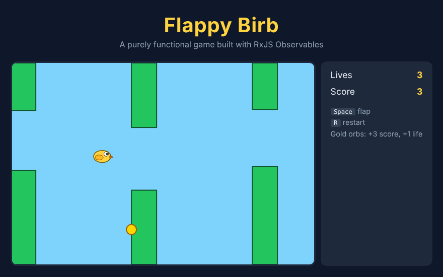

# Flappy Birb: Functional Reactive Programming

A Flappy Bird–style browser game written in **TypeScript** using **functional reactive programming (FRP)** with **RxJS**. The whole game is one stream of immutable states. Every input and timer becomes a pure function `State → State`, and the renderer is the only code that touches the DOM.

**Play it:** https://ausafayaz.github.io/flappy-birb-frp/



## Features

- **Physics:** gravity, flapping, and bounces off pipes, floor and ceiling (each hit costs a life)
- **Data-driven levels:** pipe positions and timings are read from a CSV file
- **Power-ups:** gold orbs appear every 8 seconds and give +3 score and +1 life
- **Ghost replays:** press **R** to restart, and every previous run replays as a translucent "ghost" bird alongside you
- **Win/lose states:** reach 15 points or clear every pipe to win, or lose all 3 lives
- **Level generator:** a seeded script creates fair, reproducible levels in which each gap is reachable from the last

## Controls

| Key | Action |
|-----|--------|
| Click / <kbd>Space</kbd> | Start the game |
| <kbd>Space</kbd> | Flap |
| <kbd>R</kbd> | Restart (your last run becomes a ghost) |

## How it works

```
 keydown(Space) ──► flap      ┐
 keydown(R)     ──► restart   ├─ merge ─► scan(apply) ─► state$ ─► render
 interval(16ms) ──► tick(dt)  ┘
                     └─ advance physics, then spawn pipes / power-ups
                        that are due at the current game time
```

1. **Events become reducers.** Each source Observable is mapped to a reducer, a pure function that takes the current `State` and returns the next one (`flap`, `tick`, `restart`).
2. **Merge and fold.** All reducer streams are merged and folded with `scan`, which produces a single `Observable<State>`.
3. **Render.** One subscriber draws each state to the SVG canvas. Rendering never feeds back into the game logic.

Pipes and power-ups are spawned from **game time** (`state.t`) inside `tick`, not from separate wall-clock timers. Restarting resets game time, so every run, including runs with ghosts, replays the whole level from the start.

Because the state is a plain immutable value and the reducers are pure, the game logic can be unit-tested without a browser (see `test/game.test.ts`).

### Ghost replays

During a run, every frame appends a `{ t, y }` sample to the current trail. On restart, the trail is saved as a ghost path. While rendering, each ghost's position is found by linearly interpolating between the two samples around the current time, so ghosts move smoothly whatever the frame timing.

## Project structure

```
src/
  game.ts     # state types, config, pure helpers, reducers and the state$ stream
  view.ts     # SVG rendering (the only DOM code)
  main.ts     # loads the level, waits for start, subscribes the renderer
  style.css
scripts/
  make-level.ts  # seeded level generator → public/map.csv
public/
  map.csv        # current level
test/
  game.test.ts   # unit tests for parsing, collisions, ghosts and reducers
```

## Getting started

Requires Node.js 20+.

```bash
npm install
npm run dev        # start the dev server, then open the printed URL
npm test           # run the unit tests
npm run build      # production build into dist/
```

Generate a new level (optionally with a pipe count and a seed):

```bash
npm run level -- 25 42
```

## Tech

TypeScript · RxJS · Vite · Vitest · SVG
